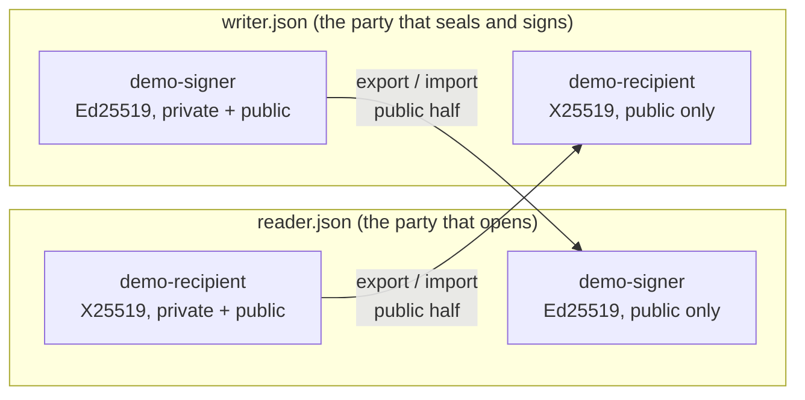

# Keyrings and Secret Tokens with flechtctl

[`flechtctl`](https://pypi.org/project/flechtctl/) is a small companion package: a
command line tool and a library for the two things the
[Encrypted Secrets](../concepts/secrets.md) feature needs outside a running stage —
**keyrings** (create them, edit them, hand a public half to somebody else) and **secret
tokens** (seal, open, sign and verify a value, or look at what a token says about itself).

It depends on [joserfc](https://jose.authlib.org/) only. It does not import Flechtwerk, so a
form backend, a deployment script or a producer in another project can use it without
installing Kafka clients, RocksDB or anything else — and `uvx` runs it on any supported
Python, including versions the full framework does not install on yet. A stage that
declares `ENCRYPTED` attributes gets it automatically: `flechtwerk[secrets]` depends on
the matching `flechtctl` version.

## Install

```bash
uvx flechtctl --help            # run it once, nothing installed
uv tool install flechtctl       # install the command
pip install flechtctl           # or use it as a library
```

`flechtctl --version` prints the installed version.

!!! note "No environment variables"

    The command reads none. Every command that needs key material takes the keyring
    explicitly with `-k/--keyring PATH`, so what a command does is visible on the line
    you typed.

## A Keyring Is a Keystore

A keyring file is a set of **named entries**, one per `kid`, much like a Java keystore.
An entry is one of three kinds:

| Kind | What it does | Private half present | Public half only |
|---|---|---|---|
| `oct` | a shared 32-byte secret: seals and opens | seals and opens | — (an oct key has no public half) |
| `x25519` | a recipient key: the public half seals, the private half opens | a **reader** — opens | a **writer** — seals, cannot open |
| `ed25519` | a signing key: the private half signs, the public half verifies | a **signer** — signs | a **reader** — verifies |

Beside the keys, the file records which entry is the **primary** (the sealing key used when
nothing says otherwise), which entry seals or signs for which **scope**, and — for every
public-key entry, always — the scopes the entry is bound to. The format is an RFC 7517 JWK
Set, described in [The Keyring](../concepts/secrets.md#the-keyring).

Moving key material between parties works **per entry**, never by copying a whole file:

- `keyring export KEYRING KID` prints the **public half of one entry** as a single JWK. The
  keyring itself is left untouched, and no private half ever appears in the output.
- `keyring import KEYRING JWKFILE` adds one JWK — typically somebody's export — as a new
  entry of another keyring.

A shared `oct` key has no public half: it cannot be exported, and whoever needs it gets a
copy from the operator through the channel the operator trusts.



## The Quick Path: One Shared Key

For a first look, or when sealer and reader are the same deployment, one `oct` key is
enough:

```bash
flechtctl keyring new keyring.json --kid prod-2026-10
TOKEN=$(flechtctl encrypt -k keyring.json --scope api_key --string 's3cret')
flechtctl decrypt -k keyring.json --scope api_key --string "$TOKEN"
```

`keyring new` mints a fresh 32-byte key and makes it the primary; the file is written with
mode `0600`, and `new` refuses to overwrite an existing file unless you add `--force`.
`encrypt` prints a `flenc:jwe:…` token. `--string` means "this argument is a plain string":
without it the value is parsed as JSON, so `encrypt -k keyring.json '{"a": 1}'` seals an
object and `decrypt` prints it back as compact JSON. Leave the value off, or pass `-`, to read
it from standard input. `--scope` names the compartment the token belongs to — the token
refuses to open anywhere else (see [Scope](../concepts/secrets.md#scope-domain-separation)).

## A Complete Setup: Reader, Writer, Signer

Suppose a producer outside your stage should be able to hand you a secret **without being
able to read it back**, and you want to know *who* wrote it. That takes two kinds of key:
an X25519 recipient key (the producer holds only its public half) and an Ed25519 signing key
(you hold only its public half). The whole exchange, command by command:

```bash
flechtctl keyring new reader.json --kid demo-recipient --type x25519 --scope demo
flechtctl keyring export reader.json demo-recipient -o recipient.jwk
flechtctl keyring import writer.json recipient.jwk --primary
flechtctl keyring add writer.json --kid demo-signer --type ed25519 --scope demo --signing-for demo
flechtctl keyring export writer.json demo-signer -o signer.jwk
flechtctl keyring import reader.json signer.jwk
flechtctl keyring show reader.json
flechtctl keyring show writer.json
```

Step by step:

1. **The reader makes a recipient key.** `keyring new … --type x25519 --scope demo` creates
   `reader.json` with one fresh X25519 key pair bound to the scope `demo`. An X25519 key must be
   bound to at least one scope — public-key material that served every scope would be a trap.
2. **The reader exports the public half.** `keyring export` writes `recipient.jwk`: a single
   JWK that holds the public `x` and the scope binding, and no private half. It is safe to
   send to the writer through any channel.
3. **The writer imports it.** `keyring import writer.json recipient.jwk --primary` creates
   `writer.json` from that one entry and makes it the primary, so the writer can seal to the
   reader. (A new keyring needs a primary, hence `--primary`.)
4. **The writer makes a signing key.** `keyring add … --type ed25519 --scope demo --signing-for
   demo` adds a fresh Ed25519 key pair to `writer.json`, bound to `demo` and chosen as the
   signing key for that scope.
5. **The writer exports the signer's public half** to `signer.jwk` …
6. **… and the reader imports it**, which gives the reader a verify-only entry.
7. **Both sides look at what they hold.** `keyring show` prints one line per entry and never
   any key material:

    ```text
    $ flechtctl keyring show reader.json
    demo-recipient  x25519  private  scopes=demo  roles=primary
    demo-signer  ed25519  public  scopes=demo  roles=-
    $ flechtctl keyring show writer.json
    demo-recipient  x25519  public  scopes=demo  roles=primary
    demo-signer  ed25519  private  scopes=demo  roles=signing-for:demo
    ```

Now the writer signs first and then encrypts — the recommended order, because the signer's
identity stays inside the ciphertext — and the reader opens and checks:

```bash
TOKEN=$(flechtctl sign -k writer.json --scope demo --string hello | flechtctl encrypt -k writer.json --scope demo --string)
flechtctl inspect "$TOKEN"
flechtctl decrypt -k reader.json --scope demo --string "$TOKEN" | flechtctl verify -k reader.json --scope demo --string
```

The last command prints `hello`. `decrypt` opens the sealed token with the reader's private key,
and `verify` checks the signature inside it with the signer's public key, printing the value only
when it verifies. A stage gets the same two steps from
`ENCRYPTED(SIGNED(STR, scope="demo"), scope="demo")`.

`inspect` needs no keyring at all. It prints the token's **unauthenticated** header — which key
sealed it (`kid`), under which algorithm, for which scope — which is what you want when a token
fails to open and you need to know whose key it asks for:

```json
{
  "authenticated": false,
  "envelope": "flenc:jwe",
  "header": {
    "alg": "ECDH-ES+A256KW",
    "enc": "A256GCM",
    "epk": { "crv": "X25519", "kty": "OKP", "x": "…" },
    "flenc_scope": "demo",
    "kid": "demo-recipient"
  }
}
```

The writer, by design, cannot undo what it did. Trying it fails with exit status 1:

```console
$ flechtctl decrypt -k writer.json --scope demo --string "$TOKEN"
flechtctl: error: cannot decrypt secret value; scope='demo'; kid='demo-recipient'; keyring holds only the public half of 'demo-recipient': it can seal but not open
```

!!! note "This page is tested"

    The command sequence above runs verbatim, in-process, as `test_walkthrough` in
    `flechtctl/tests/ctl_cli_test.py`, and a second test checks that this page still prints
    exactly those lines. If you change one, change the other.

### Editing a Keyring

| Command | What it does |
|---|---|
| `keyring add KEYRING --kid KID [--type oct\|x25519\|ed25519] [--scope S]… [--primary] [--primary-for S]… [--signing-for S]…` | adds a freshly generated key and the roles you ask for |
| `keyring primary KEYRING KID [--scope S]` | sets the primary, or the sealing key for one scope |
| `keyring signing KEYRING KID --scope S` | sets the signing key for one scope |
| `keyring remove KEYRING KID` | drops an entry with its scope binding and roles; removing the primary is refused until another one is set |
| `keyring show KEYRING` | lists the entries |

Every edit reads the file, applies the change through the keyring's own validation — a change
that would make the keyring invalid is refused and the file is left as it was — and writes it
back atomically with mode `0600`.

## Value Commands

| Command | What it does |
|---|---|
| `encrypt -k K [--scope S] [--string] [VALUE]` | seal a value; prints `flenc:jwe:…` |
| `decrypt -k K [--scope S] [--string] [TOKEN]` | open a token; prints the value as compact JSON, or raw with `--string` |
| `sign -k K --scope S [--string] [VALUE]` | sign a value; prints `flsig:jws:…` (the scope is required) |
| `verify -k K --scope S [--string] [TOKEN]` | verify a signature; prints the value only when it verifies |
| `reencrypt -k K [--scope S] [TOKEN]` | open a token and seal it again under the scope's **current** sealing key |
| `inspect [TOKEN]` | the unauthenticated header; needs no keyring |

`reencrypt` is the rotation and migration step: it moves a token from a retired key to the
current one, from an `oct` key to a recipient key and back, and gives an unscoped token a scope
— see [Rotating Keys](../concepts/secrets.md#rotating-keys). Opening a recipient token still needs
that recipient's private half.

Errors are one line on standard error, `flechtctl: error: …`, with exit status **1** and no
traceback. A misused command line exits with status **2**. Output always ends with one newline,
and input read from standard input has exactly one trailing newline removed.

## Protecting the Master Keyring

A keyring file holds the private halves of everything in it, so the operator's **master copy**
deserves more than file permissions. `flechtctl` can keep a keyring file **password-protected**:
the JWK Set is encrypted with a password into a compact JWE (an *encrypted JWK Set*, RFC 7517
§7: `PBES2-HS512+A256KW` with 210 000 iterations, `A256GCM`). The protection is opt-in and
the file says so — a protected file starts with `ey…` instead of `{`.

```bash
flechtctl keyring new master.json --kid prod-2026-10 --encrypt        # asks for the password twice
flechtctl keyring show master.json                                    # asks for it once
flechtctl keyring protect keyring.json --password-file pw             # protect an existing plain file
flechtctl keyring unprotect master.json -o deployed.json --password-file pw
```

- **Where the password comes from.** `--password-file PATH` (the file's content, minus one
  trailing newline), or an interactive prompt when standard input is a terminal. Otherwise the
  command stops with "pass --password-file". Nothing is read from the environment. A password
  needs at least 14 bytes.
- **Every command opens a protected keyring** the same way, and every **edit keeps it
  protected**: `keyring add` on a protected file writes a protected file again (freshly
  encrypted), never a plain one.
- **`unprotect -o OUT`** writes a plain copy of the keyring to `OUT` (mode `0600`; it refuses to
  overwrite unless you pass `--force`) and leaves the protected original in place. That plain copy
  is what you hand to your deployment secret store.

The deployed copy is deliberately **not** protected. A running stage reads its keyring as plain
JSON, and a stage that needed a password at startup would need that password delivered *next to*
the file — the same secret twice, in the same place. The deployed copy is protected by the secret
store it lives in (a sealed secret, a vault); the master copy is protected by the password.
`flechtctl` is the only thing that opens a protected file; `Keyring.from_json` refuses one with a
message saying so.

## The Library

Everything the command does is a function you can import, with the keyring passed explicitly —
there is no process-global state:

```python
from pathlib import Path

from flechtctl import Keyring, decrypt, encrypt, sign, verify

keyring = Keyring.from_json(Path("writer.json").read_text())

token = encrypt(keyring, "hello", scope="demo")
```

This is the point for a **third-party producer**: it seals a value for a Flechtwerk stage without
the framework, and the stage reads it with an ordinary codec:

```python
# producer (no flechtwerk installed)
token = flechtctl.encrypt(keyring, vector_as_base64, scope="face_vector")

# stage
FACE_VECTOR = Attribute("face_vector", ENCRYPTED(BYTES, scope="face_vector"))
```

`flechtctl.encrypt(keyring, value, scope=s)` writes exactly the token that `ENCRYPTED(inner,
scope=s)` writes for `value == inner.encode(x)`. For a `BYTES` attribute, `inner.encode` gives
the base64 string, so pass that. The full list: `encrypt`, `decrypt`, `sign`, `verify`,
`reencrypt` (over JSON values), `encrypt_bytes`, `decrypt_bytes`, `sign_bytes`, `verify_bytes`
(over raw payload bytes), `read_header`, `kid_of`, `signer_of`, the key generators
`generate_oct_key`, `generate_x25519_key` and `generate_ed25519_key`, and `Keyring.to_json()` with
the per-entry `public_jwk` and `with_jwk`. A password-protected file opens with
`decrypt_keyring(text, password)` and is written with `encrypt_keyring(keyring, password)`. The
generated reference is in the [API reference](../api/index.md#flechtctl).
